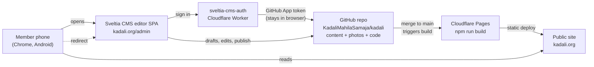
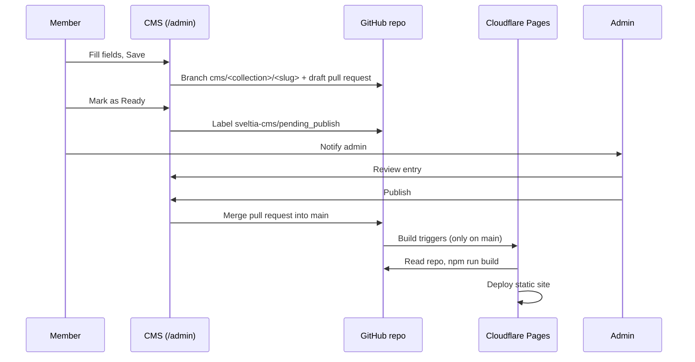
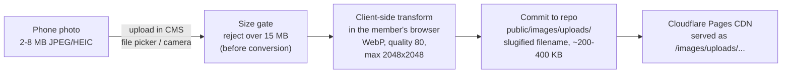

# Architecture — Kadali website

How the Kadali website is put together: the moving parts, who may do what, how images flow, and a summary of the validation research.

Practical guides: [publishing guide](publishing-guide.md) (members) and [admin guide](admin-guide.md) (administrator). Research base with source links: [validation report](validation.md).

---

## 1. Stack

| Layer | Choice |
| --- | --- |
| Site framework | Astro 5, static output (`dist/`), Tailwind CSS 4, TypeScript strict |
| Content | Astro content collections, zod-validated (`src/content.config.ts`): articles, events, announcements, galleries, site settings |
| Editor | Sveltia CMS, pinned `@0.262.4` from unpkg, served at `/admin` |
| Authentication | sveltia-cms-auth on a free Cloudflare Worker + a GitHub App scoped to the single repository |
| Hosting | Cloudflare Pages (free), builds from `main` only |
| Repository | `KadaliMahilaSamaja/kadali`, public GitHub organization repo; content, photos, and site code in one repo |
| Kannada | Noto Sans Kannada + Noto Serif Kannada variable fonts bundled locally |

## 2. Topology

The admin subdomain `admin.kadali.org` is a Cloudflare redirect rule to `kadali.org/admin`, so members only ever touch one site.

## 3. Publish flow (editorial workflow)

Configured stages are `draft` and `pending_publish` (the separate "In Review" stage is switched off in `public/admin/config.yml`). Mechanics, all verified against the Sveltia editorial workflow documentation:

- Saving never touches `main`. Each entry lives on its own branch `cms/<collection>/<slug>` with an open pull request; drafts are flagged as draft pull requests on GitHub.
- Status labels on the pull request: `sveltia-cms/draft`, `sveltia-cms/pending_publish`.
- The **Publish** action merges the pull request and deletes its branch. The **Homepage** settings collection uses simple mode instead: it saves straight to `main` and is reserved for the admin.
- Deletions also go through a pull request, so removal is reviewable too.
- The board refreshes from GitHub about once a minute, so merges done on github.com appear in the CMS as well.

## 4. Permission model and limits

### Repo roles are not CMS roles

| GitHub role | What it means here |
| --- | --- |
| Read | Cannot sign in to the CMS (read-only sign-in only works via Open Authoring forks, which we do not use) |
| Triage | Not used |
| **Write** | Club members. Can sign in, save drafts, mark Ready, create branches and pull requests |
| Maintain | Not used |
| Admin | The club administrator. Full control, bypasses the main-branch review |

There is no GitHub role that restricts a member to content files only (path-scoped custom roles exist only on Enterprise Cloud). **Documented limitation:** a Write-role member can bypass the CMS and edit any file directly on github.com. Mitigation is blast-radius control, not prevention:

- One public repository holding only website, content, and photos — no secrets anywhere (deployment credentials live in Cloudflare; the GitHub App secret lives in Worker env vars).
- `main` is protected with one required review, so nothing reaches the public site un-reviewed, even when the CMS publish button is bypassed.

### Why a member cannot publish alone

The branch protection requires one approval, and GitHub does not let a person approve their own pull request. Sveltia's publish action is a merge; a merge without the required approval is refused by GitHub. So: author writes, a second person (normally the admin) reviews and publishes. Moving an entry to Ready in the CMS records the mover's approval — which only counts when the mover is not the author.

### Scope of member sign-in

The authenticator is registered as a **GitHub App** restricted to the `kadali` repository (see the update note below). A member's token therefore grants repo-scoped Contents + Pull requests access to that one repository — not to her other GitHub repositories. The token is stored in her own browser (localStorage) and refreshed automatically; it never passes through the club's server. `ALLOWED_DOMAINS` on the Worker makes sure tokens are only released to pages served from the club's own hostname.

> Update since the validation report (2026-11-12): validation.md section 4 assumed the classic OAuth App with the repo-wide `repo` scope and recorded that GitHub Apps were unsupported. The sveltia-cms-auth README now documents GitHub App registration as the standard path, which removes the repo-wide-scope caveat. The mitigation logic (one repo per org, `ALLOWED_DOMAINS`, secrets only in Worker env) is unchanged and still applies.

### Other limits

- Draft branches are publicly readable in a public repo: drafts are never confidential.
- Unauthenticated visitors see only the CMS login screen; every content operation needs a token from a Write-role account.
- Homepage simple-mode saves commit straight to `main`; they work only for the admin via the branch-protection bypass list (admin-guide A8).

## 5. Image pipeline

- Nothing to install for members: the transform runs in the browser at upload time (Sveltia internal media library, configured in `public/admin/config.yml` under `media_libraries.default.config.transformations`).
- SVGs are optimized, not converted.
- Uploaded filenames are slugified to lowercase clean names.
- At ~300 KB per photo, thousands of photos stay under GitHub's ~1 GB guidance for years. Upgrade path if ever needed: Cloudflare R2 (10 GB free) as an external Sveltia media library — deliberately deferred (admin-guide Part E).

## 6. Build and deploy pipeline

- Cloudflare Pages project connected to `KadaliMahilaSamaja/kadali`; production branch `main`; build `npm run build`; output `dist`.
- Only merges to `main` build. Branch build controls exclude `cms/*` from preview deployments — this protects the 500 builds/month free quota, because every saved draft would otherwise trigger a build.
- A draft with empty required fields would break the Astro zod schema on its own branch; since those branches are not built, this costs nothing and production is unaffected.
- Free-plan margins: 500 builds/month, 20k files, 25 MiB per file, unlimited bandwidth; Worker 100k requests/day; GitHub guidance under ~1 GB per repo, 100 MiB per file hard cap.

## 7. Validation summary

Full report with all source links: [validation.md](validation.md) (verbatim research base, 2026-11-11).

| Requirement | Verdict | Decision shipped |
| --- | --- | --- |
| Members publish without GitHub admin rights | PASS (with caveat) | Members = Write on a public org repo; editorial workflow; `main` protected with 1 required review; Write-vs-CMS role gap documented as a limitation with mitigations |
| Zero cost | PASS | Cloudflare Pages free + Workers free + GitHub Free; build-skip for `cms/**` configured to protect the build quota |
| Non-technical sign-in | PASS | Self-hosted sveltia-cms-auth on a Worker (no hosted auth service exists — the author declines SaaS for liability reasons); GitHub App registration; `auth_methods: [oauth]`; `ALLOWED_DOMAINS` lockdown |
| Image storage | PASS | Internal Git storage with mandatory client-side transforms (WebP, 2048 px, q80, 15 MB gate); R2 documented as future upgrade; Cloudflare Images rejected (no free tier) |
| Mobile editing and WYSIWYG | ADEQUATE | Lexical rich-text editor, responsive UI, native gallery/camera picker, PWA-installable; mitigations shipped: transform config, English UI + Kannada content documented, real-Android acceptance checklist in the [publishing guide](publishing-guide.md#8-acceptance-checklist--first-test-on-a-real-android-phone) |
| Kannada UI | NOT AVAILABLE | CMS UI is English-only (38 languages, no Kannada); Kannada typing inside content fields works normally; guides use English labels with Kannada glosses |

Caveats carried into delivery: real-Android acceptance test is a required manual step; CMS UI language is English; the GitHub App update above replaces the report's OAuth-App scope caveat.
